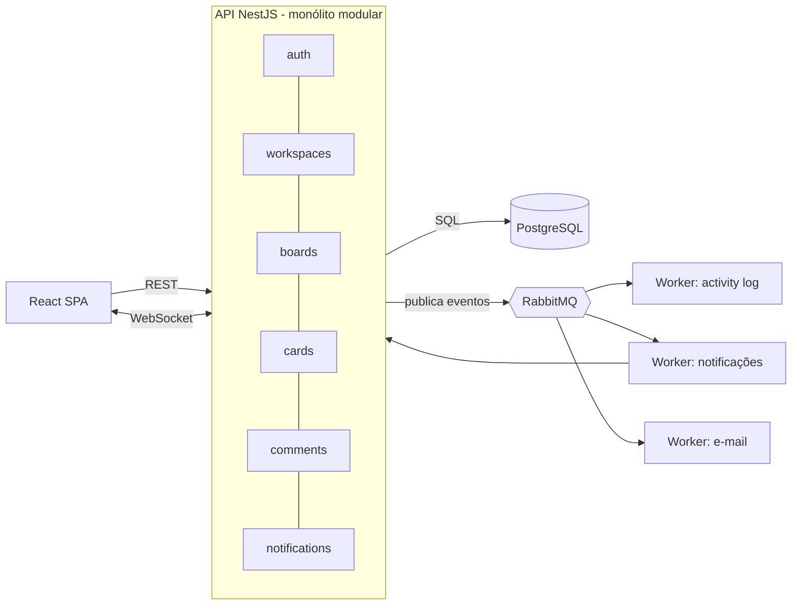

# Arquitetura

## Visão geral

O TaskFlow é um **monólito modular** (NestJS) com front React e mensageria via RabbitMQ para
trabalho assíncrono. A decisão está registrada em [ADR 0001](adr/0001-modular-monolith.md).

## Estado atual (Marco 0)

Apenas a fundação existe: monorepo, infraestrutura local (Postgres + RabbitMQ), CI e um endpoint
`GET /health` consumido pelo front. Os módulos de domínio entram nos marcos seguintes.

## Roadmap

| Marco | Tema                           | Status |
| ----- | ------------------------------ | ------ |
| 0     | Fundação                       | ✅     |
| 1     | Autenticação                   | ⬜     |
| 2     | Workspaces e permissões        | ⬜     |
| 3     | Boards, colunas e cards        | ⬜     |
| 4     | Tempo real (WebSocket)         | ⬜     |
| 5     | RabbitMQ e processamento async | ⬜     |
| 6     | Qualidade e entrega            | ⬜     |
